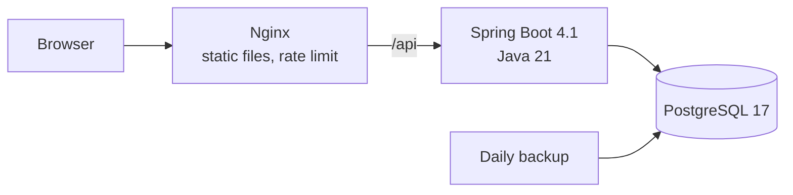

# Testa

**English** | [繁體中文](README.zh-TW.md)

Testa is a self-hosted online exam system for schools. Teachers write question banks, an exam officer schedules the exam and prints login slips, candidates take it in a computer lab or online, essays are graded anonymously, and results are published, all on one server the school runs itself.


| Proctoring | Taking the exam |
| --- | --- |
|  |  |

More in [Screenshots](docs/screenshots.md).

## Features

**Authoring**
- Single choice, multiple choice, fill-in-the-blank and essay questions, with math typed as `$...$` and rendered by KaTeX.
- Autosave with version conflict detection, and a "try it" mode that shows the bank exactly as a candidate sees it.
- Optional: a local AI model drafts questions from an existing Word or PDF paper, and the author confirms each one. Off by default.

**Running an exam**
- Roster import from Excel or CSV (including Big5) and printable login slips; login codes are stored only as hashes and shown once, when the slips are printed.
- Candidates need no account: candidate number plus login code, one active session per candidate.
- The server owns the clock: autosave, resume after a disconnect, auto-submit at time-up, per-candidate extra time.
- Live proctoring: status filters, lockout after wrong codes, a count of how often a candidate left the exam window.

**Grading and results**
- Choice and fill-in questions are graded automatically.
- Essays are graded anonymously by one or more graders; the score is their average, and large disagreements are flagged before publishing.
- Results are locked on publishing and exported to Excel or CSV for the school's own announcement; each exam can also let candidates sign in to see their total and subtotals.

**Operations**
- No default credentials: the first administrator is created on a first-run setup page that closes for good afterwards.
- Append-only audit log for sensitive actions; administrators cannot see papers unless an exam owner grants time-limited access.
- Needs no Internet during an exam, so lab PCs can be blocked from it: fonts, math and scripts are bundled, and sessions live in the database, so a restart signs no one out.
- Docker Compose deployment with Nginx, daily database backups and an end-to-end smoke test. Administrators can create, download, delete and restore backups in the admin panel; destructive actions ask for confirmation, and a restore must be confirmed by typing a word.

## Design principles

- **The server is the source of truth.** Timing, submission and grading happen only on the backend; the browser clock is for display.
- **Nothing leaks to candidates.** Papers sent to candidates never contain answers, explanations or rubrics, and a test enforces it.
- **Least privilege by default.** Every permission check goes through one guard; a person sees an exam only through a role in its unit.
- **Simple to operate.** One VM, one Compose file, no external services. Resilience comes from restarts, extra time and rehearsed restores rather than clustering.

## Quick start

Requires Docker, JDK 21+ and Node 22.

```bash
docker compose up -d                                                  # PostgreSQL on localhost:5432
cd server && ./mvnw spring-boot:run -Dspring-boot.run.profiles=dev    # backend on :8080 with demo data
cd testa && npm install && npm run dev                                # frontend on :5173
```

Open <http://localhost:5173>. The sign-in page offers one-click demo accounts:

| Role | Account | Password |
| --- | --- | --- |
| System administrator | admin@testa.tw | testa-admin |
| Exam officer (owner + proctor) | officer@testa.tw | testa-officer |
| Teacher (author + grader) | teacher@testa.tw, teacher2@, teacher3@ | testa-teacher |
| Candidate | candidate number A115-0001 | login code 482915 |

Demo accounts exist only in the `dev` profile. To run Testa for real, follow the [Deployment guide](docs/deployment.md).

## Architecture



| Directory | Contents |
| --- | --- |
| [testa/](testa/) | Frontend: Vue 3, TypeScript, Vite, Tailwind CSS v4 |
| [server/](server/) | Backend: Spring Boot, Flyway, Spring Session (JDBC) |
| [deploy/](deploy/) | Nginx config, backup script, environment template, smoke test |
| [docs/](docs/) | Guides and design documents ([index](docs/README.md)) |
| [tools/](tools/) | Developer tools (local AI model evaluation, screenshot capture) |

## Roles

Roles are granted per unit (for example, an admissions office), and one person can hold several.

| Role | Can |
| --- | --- |
| Owner | Schedule exams, import rosters, assign graders, publish results, archive and delete exams, manage unit members |
| Author | Create and edit question banks |
| Proctor | Watch candidates, reset login codes, give extra time |
| Grader | Grade assigned essays without seeing names or other graders' scores |
| System administrator | Manage accounts and units, read the audit log, manage backups, change system settings |
| Candidate | No account; signs in with the login slip to take the exam (and check the score, if the exam allows it) |

## Documentation

| Document | Contents |
| --- | --- |
| [Deployment](docs/deployment.md) | Installation, HTTPS, network options, upgrades, backup and restore |
| [Server requirements](docs/server-requirements.md) | One table of what to request: VM size, network, certificate |
| [Development](docs/development.md) | Code layout, backend rules, tests, contributing |
| [Frontend](testa/README.md) | Pages, components, design tokens, UI rules |
| [Project status](docs/status.md) | What is done, how it was verified, roadmap |
| [Screenshots](docs/screenshots.md) | Every page on desktop and phone |
| [School accounts](docs/school-accounts.md) | Proposal: internal exams with school sign-in |
| [AI features](docs/ai.md) | AI question import, the evaluation of local models, and the design for other AI-assisted features |
| [Design document](docs/testa-system-design.html) | Original requirements (Traditional Chinese; open in a browser) |

## Project status

Feature-complete for its first use, a school admission exam, and verified end to end on production images, including a 300-candidate load test and a backup restore. On-site trials (lab network, printers, browsers other than Chromium) are still ahead. See [Project status](docs/status.md) for details and the roadmap.

## Contributing

Issues and pull requests are welcome. Read [Development](docs/development.md) first: it covers the rules that keep exams fair and data private, and the checks to run before a pull request.

## License

Testa is free software under the [GNU Affero General Public License v3.0](LICENSE). You may use, modify and share it; if you run a modified version as a service for others, you must offer them its source code.
