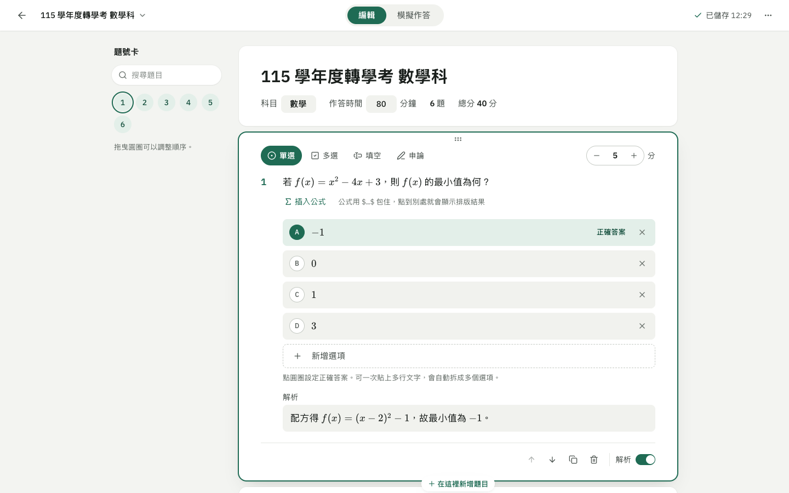
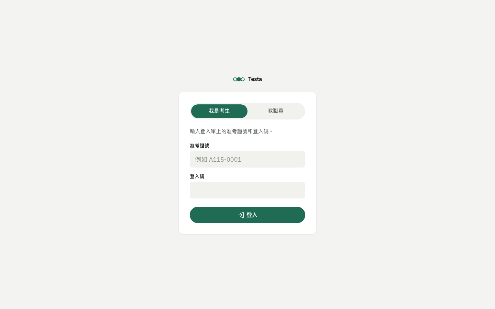
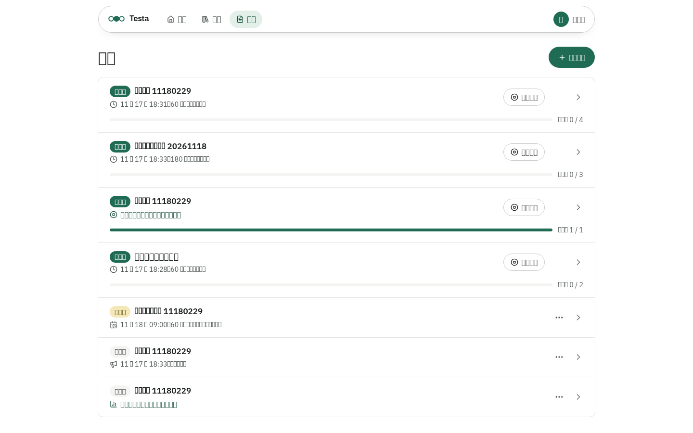
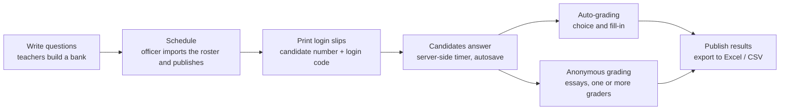
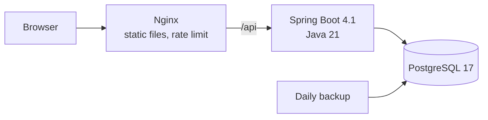

# Testa

**English** | [繁體中文](README.zh-TW.md)

A self-hosted online exam system for schools: write questions, schedule an exam, let candidates take it in a computer lab, grade essays anonymously and publish the results.



| Login | Exams |
| --- | --- |
|  |  |

## Documentation

| Document | Contents |
| --- | --- |
| [Design document](docs/testa-system-design.html) | Requirements, roles, flows and open questions (Chinese; open in a browser) |
| [Status](docs/status.md) | What is done, what was tested, what is left |
| [Deployment](docs/deployment.md) | Going live, HTTPS, network and offline exams, upgrades, backup and restore |
| [Development](docs/development.md) | Layout, backend conventions, tests |
| [Frontend](testa/README.md) | Pages, component layout, design tokens, UI principles |
| [AI research](docs/ai.md) | Local model trials: question import, grading assistance, MCP |

## How an exam works



## Roles

One person can hold several roles in the same unit.

| Role | Can |
| --- | --- |
| Owner | Schedule exams, import rosters, assign graders, see results, archive and delete exams, manage unit members |
| Author | Create and edit question banks |
| Proctor | Watch candidate status, lock and unlock, reset login codes, give a candidate extra time |
| Grader | Grade assigned essay questions (no candidate names, no other graders' scores) |
| System administrator | Manage accounts and units, read the audit log and backups. Cannot see papers or scores unless a unit owner grants time-limited emergency access |
| Candidate | No account. Signs in with the candidate number and login code on the slip to take the exam and check the score |

## Architecture



| Directory | Contents |
| --- | --- |
| [testa/](testa/) | Frontend: Vue 3, TypeScript, Vite, Tailwind CSS v4 |
| [server/](server/) | Backend: Spring Boot, Flyway, Spring Session (JDBC) |
| [deploy/](deploy/) | Nginx config (HTTP and HTTPS), backup script, env template, smoke test |
| [docs/](docs/) | Design document and guides |
| [tools/](tools/) | Developer tools: local AI model evaluation |

## Quick start

Needs Docker, JDK 21+ and Node 22. In three terminals:

```bash
docker compose up -d                                                  # PostgreSQL on localhost:5432
cd server && ./mvnw spring-boot:run -Dspring-boot.run.profiles=dev    # backend on :8080, creates tables and demo accounts
cd testa && npm install && npm run dev                                # frontend on :5173
```

Open <http://localhost:5173>. The login page has one-click demo sign-ins:

| Identity | Account | Password |
| --- | --- | --- |
| System administrator | admin@testa.tw | testa-admin |
| Exam officer (owner + proctor) | officer@testa.tw | testa-officer |
| Teacher (author + grader) | teacher@testa.tw, teacher2@, teacher3@ | testa-teacher |
| Candidate | candidate number A115-0001 | login code 482915 |

Demo accounts exist only in the dev profile. For production, see [Deployment](docs/deployment.md).

## Status

- All seven first-release items in the design document are done.
- The production images were built on a development machine and passed a full mock exam, a 300-candidate load test and a backup restore.
- The school's four decisions of 2026-11-14 are implemented: retention and archiving, grader disagreement warnings, authors may grade, emergency access for administrators.
- Not yet on the school's server; the on-site network, other browsers and printed slips are untested.
- Target: live before the end of 2026, first used for the admission exam.

Details in [Status](docs/status.md).
