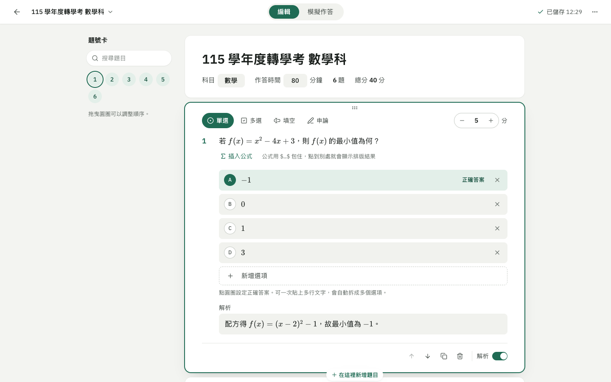
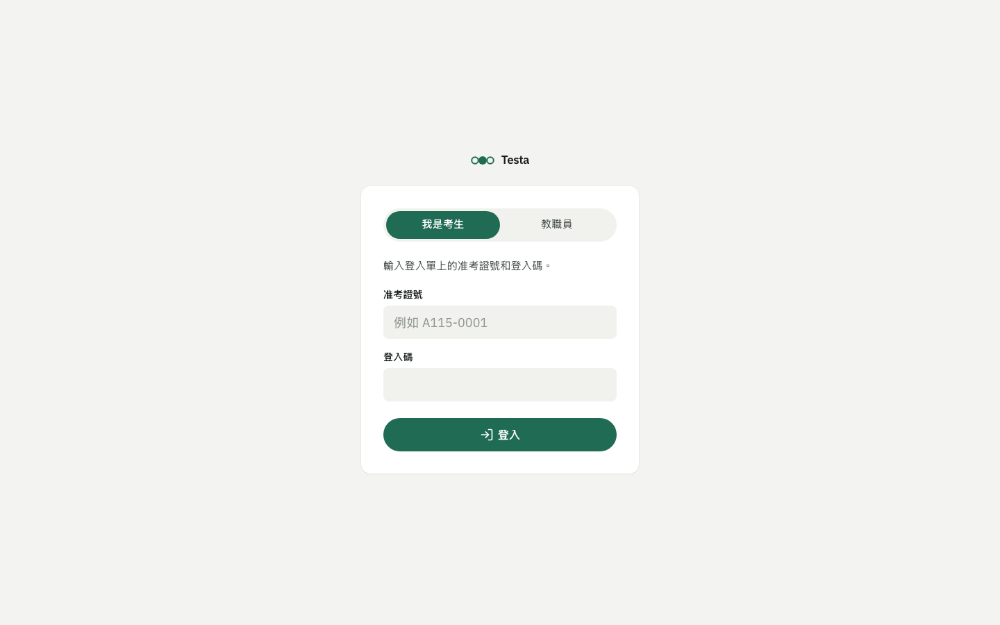
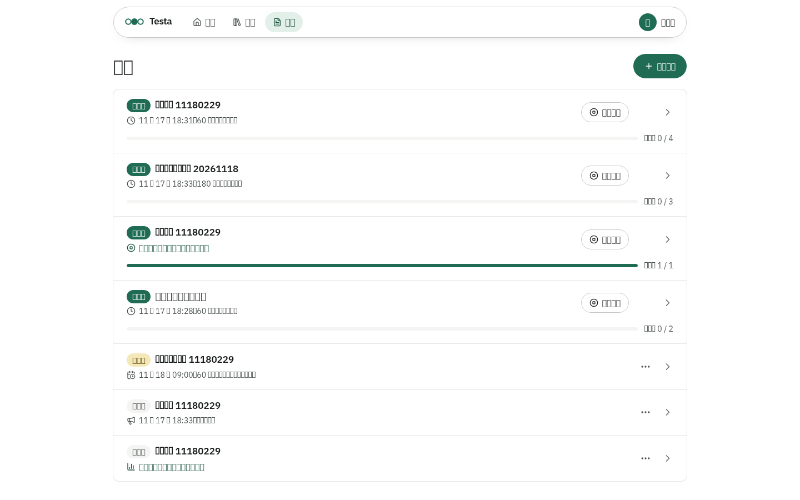
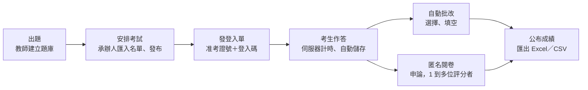

# Testa 考試平台

[English](README.md) | **繁體中文**

學校自行架設的線上考試系統：出題、安排考試、考生在電腦教室作答、匿名閱卷、公布成績。



| 登入 | 考試管理 |
| --- | --- |
|  |  |

## 文件

各文件以英文撰寫，設計文件為中文。

| 文件 | 內容 |
| --- | --- |
| [設計文件](docs/testa-system-design.html) | 需求、角色、流程、待確認事項（用瀏覽器開） |
| [進度與測試](docs/status.md) | 做完什麼、測過什麼、還沒做什麼 |
| [部署](docs/deployment.md) | 上線、HTTPS、網路與斷網考試、升級、備份與還原 |
| [開發](docs/development.md) | 專案結構、後端慣例、測試 |
| [前端](testa/README.md) | 頁面、元件結構、design tokens、介面原則 |
| [AI 研究](docs/ai.md) | 本地模型實測：出題導入、改題、MCP |

## 一場考試的流程



## 角色

一個人在同一個單位可以同時有多個角色。

| 角色 | 能做的事 |
| --- | --- |
| 負責人 | 安排考試、匯入名單、指派評分者、看成績、封存與刪除考試、管理單位成員 |
| 出題 | 建立與編輯題庫 |
| 監考 | 看考生狀態、鎖定與解鎖、重設登入碼、替個別考生補時 |
| 評分 | 批改被指派的申論題（看不到考生姓名與其他人的分數） |
| 系統管理員 | 管理帳號與單位、看操作紀錄與備份；看不到考卷與成績，除非單位負責人授權限時檢視 |
| 考生 | 沒有帳號，用登入單上的准考證號＋登入碼作答、查成績 |

## 快速開始

需要 Docker、JDK 21 以上、Node 22。開三個終端機：

```bash
docker compose up -d                                                  # PostgreSQL（localhost:5432）
cd server && ./mvnw spring-boot:run -Dspring-boot.run.profiles=dev    # 後端 :8080，自動建表與示範帳號
cd testa && npm install && npm run dev                                # 前端 :5173
```

打開 <http://localhost:5173>，登入頁下方可以一鍵用示範身分登入：

| 身分 | 帳號 | 密碼 |
| --- | --- | --- |
| 系統管理員 | admin@testa.tw | testa-admin |
| 承辦人（負責人＋監考） | officer@testa.tw | testa-officer |
| 教師（出題＋評分） | teacher@testa.tw、teacher2@、teacher3@ | testa-teacher |
| 考生 | 准考證號 A115-0001 | 登入碼 482915 |

示範帳號只在 dev profile 出現。正式部署看[部署文件](docs/deployment.md)。

## 目前狀態

- 設計文件「第一版要做」的七項都已完成。
- 正式環境的映像檔已在開發機建置，跑過整場模擬考、300 人負載、備份還原。
- 學校 2026-11-14 回覆的四項決定已實作：保存期限與封存、評分差距警示、出題者可評分、管理員緊急檢視。
- 還沒上學校的主機；現場網路、其他瀏覽器、印表機輸出還沒測。
- 目標：2026 年底前上線，先用在招生考試。
