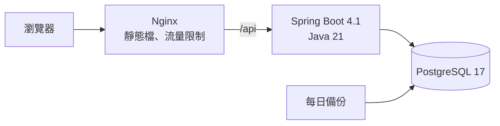

# Testa 考試平台

[English](README.md) | **繁體中文**

Testa 是學校自行架設的線上考試系統。教師建立題庫，承辦人安排考試並列印登入單，考生在電腦教室作答，申論題匿名閱卷，最後公布成績。整套系統跑在校內的一台伺服器上。


| 監考 | 考生作答 |
| --- | --- |
|  |  |

更多畫面請看[截圖](docs/screenshots.md)。

## 功能

**出題**
- 單選、多選、填空、申論四種題型；數學式用 `$...$` 輸入，以 KaTeX 呈現。
- 自動儲存並偵測多人同時編輯的衝突；「模擬作答」可以用考生的畫面試考一次。
- 選用功能：用本地 AI 模型把現有的 Word、PDF 考卷拆成題目，每一題都要出題者確認。預設關閉。

**考試**
- 從 Excel 或 CSV（支援 Big5）匯入名單，每位考生一組登入碼，可直接列印登入單。
- 考生不用帳號：准考證號加登入碼，同一位考生同時只能有一個連線。
- 時間由伺服器控制：自動儲存、斷線後接續作答、時間到自動交卷、可替個別考生補時。
- 即時監考：依狀態篩選、登入碼輸錯會鎖定、記錄離開考試畫面的次數。

**閱卷與成績**
- 選擇題、填空題自動批改。
- 申論題由一到多位評分者匿名評分，取平均；評分差距過大時，公布前會提醒。
- 公布即鎖定成績，可匯出 Excel 或 CSV 交給學校放榜；每場考試也可以開放考生登入查詢總分與小計。

**維運**
- 沒有預設帳密：第一位管理員要用伺服器 log 裡的一次性代碼建立。
- 敏感操作都寫進不可修改的操作紀錄；系統管理員看不到考卷，除非考試負責人授權限時檢視。
- 不需要網際網路：字型、數學式、程式都打包在內；登入狀態存在資料庫，重開機不會把人登出。
- 用 Docker Compose 部署，內含 Nginx、每日資料庫備份，以及整場模擬考的自動測試。

## 設計原則

- **以伺服器為準。** 計時、交卷、批改只在後端進行，瀏覽器上的倒數只是顯示。
- **答案不外流。** 送給考生的試卷不含答案、解析與評分規準，並有測試把關。
- **預設最小權限。** 所有權限檢查走同一個關口；要看到一場考試，必須在該單位有對應角色。
- **好維運。** 一台 VM、一個 Compose 檔、不依賴外部服務。可靠性來自重啟、補時與演練過的還原，而不是叢集。

## 快速開始

需要 Docker、JDK 21 以上、Node 22。

```bash
docker compose up -d                                                  # PostgreSQL（localhost:5432）
cd server && ./mvnw spring-boot:run -Dspring-boot.run.profiles=dev    # 後端 :8080，含示範資料
cd testa && npm install && npm run dev                                # 前端 :5173
```

打開 <http://localhost:5173>，登入頁可以一鍵用示範帳號登入：

| 身分 | 帳號 | 密碼 |
| --- | --- | --- |
| 系統管理員 | admin@testa.tw | testa-admin |
| 承辦人（負責人＋監考） | officer@testa.tw | testa-officer |
| 教師（出題＋評分） | teacher@testa.tw、teacher2@、teacher3@ | testa-teacher |
| 考生 | 准考證號 A115-0001 | 登入碼 482915 |

示範帳號只存在於 `dev` profile。正式上線請照[部署指南](docs/deployment.md)。

## 架構



| 目錄 | 內容 |
| --- | --- |
| [testa/](testa/) | 前端：Vue 3、TypeScript、Vite、Tailwind CSS v4 |
| [server/](server/) | 後端：Spring Boot、Flyway、Spring Session（JDBC） |
| [deploy/](deploy/) | Nginx 設定、備份腳本、環境變數範本、整場測試 |
| [docs/](docs/) | 指南與設計文件 |
| [tools/](tools/) | 開發工具（本地 AI 模型評測） |

## 角色

角色依單位（例如招生組）指派，一個人可以同時有多個角色。

| 角色 | 能做的事 |
| --- | --- |
| 負責人 | 安排考試、匯入名單、指派評分者、公布成績、封存與刪除考試、管理單位成員 |
| 出題 | 建立與編輯題庫 |
| 監考 | 看考生狀態、重設登入碼、補時 |
| 評分 | 批改被指派的申論題，看不到考生姓名與其他人的分數 |
| 系統管理員 | 管理帳號與單位、查看操作紀錄與備份狀態 |
| 考生 | 沒有帳號，用登入單作答（該場考試有開放時也能查成績） |

## 文件

除了設計文件，其他文件都以英文撰寫。

| 文件 | 內容 |
| --- | --- |
| [部署](docs/deployment.md) | 安裝、HTTPS、斷網考試、升級、備份與還原 |
| [主機需求](docs/server-requirements.md) | 一張表：要申請的 VM 規格、網路、憑證 |
| [開發](docs/development.md) | 程式結構、後端規則、測試、如何貢獻 |
| [前端](testa/README.md) | 頁面、元件、design tokens、介面規則 |
| [專案狀態](docs/status.md) | 完成度、驗證方式、路線圖 |
| [截圖](docs/screenshots.md) | 每個畫面的桌機與手機版 |
| [校務帳號](docs/school-accounts.md) | 提案：校內考試用校務帳號登入 |
| [AI 功能](docs/ai.md) | AI 匯入題目、本地模型評測，以及其他 AI 輔助功能的設計 |
| [設計文件](docs/testa-system-design.html) | 原始需求（用瀏覽器開） |

## 專案狀態

第一個用途（學校招生考試）需要的功能都已完成，並在正式環境的映像檔上做過完整驗證，包含 300 人同時作答與備份還原。現場測試（電腦教室網路、印表機、Chromium 以外的瀏覽器）還沒進行。細節與路線圖請看[專案狀態](docs/status.md)。

## 參與貢獻

歡迎提 issue 與 pull request。請先讀[開發文件](docs/development.md)，裡面有確保考試公平與資料隱私的規則，以及送 PR 前要跑的檢查。

## 授權

Testa 以 [GNU Affero General Public License v3.0](LICENSE) 釋出，是自由軟體。你可以使用、修改與散布；若把修改過的版本架成服務提供給他人使用，必須同時提供它的原始碼。
