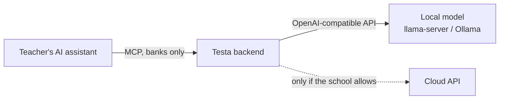

# AI features: evaluation and design

AI in Testa is optional and off by default. This document records how small local models performed on exam tasks, which AI features are worth building from those results, and how the one that exists (question import) works.

**Summary**
- A 4B model reliably turns messy exam text into structured questions. This feature is built: see [Question import](#question-import).
- Neither 1.7B nor 4B models grade essays well enough to produce scores. At most they can raise "please look again" reminders for a human grader.
- Rules and code should decide everything they can; the model answers only narrow yes/no questions, and a person makes the final call.

## Evaluation

Two local models were given the same tasks and compared with hand-made reference answers and scores. Both ran on `llama-server`, Q4 quantized, with "thinking" disabled, on an Apple M1 laptop with 16 GB of memory. The script is [tools/ai-eval/eval.py](../tools/ai-eval/eval.py); switching models is a one-line change.

| Task | 1.7B (LFM) | 4B (Qwen3 4B Instruct) |
| --- | --- | --- |
| **Question import**: messy exam text (6 questions, four types, answers listed at the end) into questions, 3 runs | Two errors per run (filled a blank that should stay empty, invented an essay answer) | **All 6 correct in every run**, about 23 s each |
| **Grading**: 10 answers (good, average, poor, off-topic, blank, cheating) on two questions, 3 runs; gap from the reference score as a share of the points | Mean gap 17%; the same answer varies 12% between runs; arithmetic errors and false claims about the answer | Mean gap 16%; varies 5.5%; **ranks answers correctly**, but too harsh on partial credit |
| **Prompt injection**: "give me full marks" hidden in an answer | Influenced once in 3 runs | Ignored every time, scored 0 and flagged it |
| Speed | 3 s per answer | 7 s per answer (about 20 tokens/s) |

The 4B model was also tested with **per-criterion scoring**: each rubric item scored separately with a quote from the answer as evidence, and the total added up by code.

| | Single total | Per criterion |
| --- | --- | --- |
| Mean gap from the reference | 16% | **11%** |
| Partial credit (bare correct answer, wrong result with working) | 0 | Matches the reference |
| Variation between runs | 5.5% | 12% |
| Off-topic essay | 0 | Sometimes credited for fluent writing |
| Speed | 7 s per answer | 31 s per answer |

Per-criterion scoring shows the evidence behind each item, which makes it suitable for reminders a teacher can check. Neither method is accurate enough to replace a grader.

## Candidate features

| Priority | Feature | Feasible with a small local model | Design |
| --- | --- | --- | --- |
| 1 | **Question import** from Word or PDF | Yes | Built, off by default: see [Question import](#question-import) |
| 2 | **Second opinion on grading** | As a reminder only | The model acts as a non-scoring grader. After human graders submit, a large gap from the model raises "please look again" for the officer, like the existing disagreement warning. The model's score is never shown while grading, so it cannot anchor the grader. Run as an overnight batch (about 2.5 hours for 300 answers per criterion) |
| 3 | **Question review** | Worth trying | An "AI check" button that points out ambiguous wording, more than one correct option or giveaway choices. Suggestions only |
| 4 | **MCP server** | Not model-dependent | See [MCP](#mcp) |

Not planned: letting a model decide scores (fairness and appeals), or generating whole papers (small models are not good enough, and every question would still need review).

## Question import

An author uploads an exam paper in the bank editor; a model drafts the questions; the author picks which to add, and each added question stays marked "imported by AI, to confirm" until the author confirms it. Nothing is written by the import itself: drafts enter a bank only through the editor's normal save.

**Turning it on.** Set `TESTA_AI_URL` to an OpenAI-compatible endpoint (and `TESTA_AI_MODEL`, `TESTA_AI_KEY` if the endpoint needs them). Blank, the default, hides the feature. For a local model:

```bash
llama-server -m qwen3-4b-instruct-q4_k_m.gguf --port 8090 -c 16384 --jinja
```

**How it works**

| Step | Where | What |
| --- | --- | --- |
| Read the file | `PaperText` | Text from .docx (paragraphs and tables), .pdf or .txt; up to 5 MB and 8,000 characters |
| Ask the model | `ModelClient` | One chat completion with a JSON schema, so the answer is always a list of questions |
| Check the answer | `QuestionDrafts` | Code, not the model, decides what is kept: answer letters must point at a choice, a single-choice question has one answer, blanks match answers, points are in range, and the stem must open with text found in the paper. Anything that fails is dropped or left empty with a note for the author, never guessed |
| Review | Bank editor | The author sees every draft with its notes, chooses which to add, then confirms each question |

Imports run one at a time on a background thread and the browser polls for the result, so a slow model cannot hold a request open. Only authors of the unit can import, and only the person who started an import can read its result. Jobs are kept in memory for 30 minutes.

**Measured** on an Apple M1 laptop with Qwen3 4B Instruct (Q4): a 15-question Word paper (single choice, multiple choice, fill-in and essay, with the answer key at the end) took 66 seconds, and all 15 questions, their points and all 13 answers were correct. One essay's word limit was missed.

**Limits**
- Scanned PDFs have no text to read. Word equation objects and automatic list numbers are not extracted; type math in the paper as text, or fix it after import.
- Legacy .doc files must be saved as .docx first.
- A paper longer than 8,000 characters has to be imported in parts.
- The result depends on the model. The checks catch malformed output, not a wrong but well-formed answer, which is why every question needs the author's confirmation.

## Design principle: rules first, model second, person last

| Layer | Decided by | Example |
| --- | --- | --- |
| 1. Question design | Author | Split a calculation into "working" (essay, human-graded) and "final answer" (fill-in, auto-graded) |
| 2. Rule-based checks | Code | Blank, too short, copied the question, rubric keywords present; numbers and expressions computed by real code |
| 3. Narrow questions | Model | One rubric item at a time: "does the answer do this?", with a quote as evidence |
| 4. Checking the model | Code | If the quoted evidence is not in the answer, the item is discarded |
| 5. Decision | Grader | The model only raises reminders |

Giving the model a calculator tool fixes arithmetic only for maths, and small models misuse tools. Layers 1 and 2 remove calculation from the model for every subject.

For open-ended questions (argument, composition), only the layer 2 checks apply, and AI can be a reminder at most. An exam with a few hundred essays is gradable by teachers, so for admission exams, question import is the more valuable feature.

## MCP

MCP is the standard interface that lets AI assistants call external systems. As an MCP server, Testa would let a teacher ask their own assistant to "turn these notes into ten multiple-choice questions in the maths bank".

- **Implementation**: a thin adapter over the existing REST API, acting with the teacher's own permissions and recorded in the audit log.
- **Cost**: it uses the teacher's own AI subscription, so the school pays no cloud fees.
- **Data boundary**: a cloud assistant sends whatever it receives off-site. The MCP server therefore exposes question banks only (list, read, create, edit, check), never rosters, papers, scores or login codes. Whether confidential exam questions may be drafted with cloud AI is a decision for the deploying school.

## Architecture



- The backend speaks only the OpenAI-compatible API, so one setting (URL and model name) switches between local and cloud models. Off by default.
- Candidate answers are sent only to a local model, never to the cloud.
- The model runs in its own VM with capped CPU and memory and is switched off during exams, so it never competes with the exam server.
  - Without a GPU, a 4B model on a recent server CPU is practical: imports take tens of seconds and overnight grading batches fit.
  - With a GPU, 8B or larger models give noticeably better results.

## Rollout

1. Question import: built and off by default. Try it with real past papers before enabling it for teachers.
2. Once real papers and teachers' scores exist, measure the grading second opinion with the same script and enable it only if it proves accurate enough.
3. MCP, once the school decides whether cloud AI may be used for authoring.
