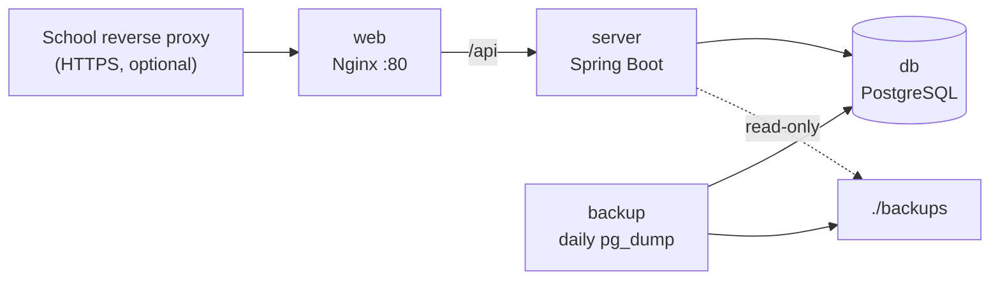

# Deployment



Only Nginx is exposed (port 80 by default). All four containers are in `docker-compose.prod.yml`.

## Going live

```bash
cp deploy/env.example .env      # database password and the first system administrator
docker compose -f docker-compose.prod.yml up -d --build
```

| Variable | Meaning |
| --- | --- |
| `TESTA_DB_PASSWORD` | Database password; generate a long random string |
| `TESTA_ADMIN_EMAIL`, `TESTA_ADMIN_PASSWORD` | First system administrator. Used only while the database has none; must change the password after signing in |
| `TESTA_HTTP_PORT` | Public port, default 80 |
| `TESTA_COOKIE_SECURE` | Keep `true` behind HTTPS |
| `TESTA_BACKUP_DIR`, `BACKUP_KEEP_DAYS` | Where backups go (default `./backups`) and for how many days (default 30) |

> **Plain HTTP on a LAN**: set `TESTA_COOKIE_SECURE` to `false`, or users are signed out right after signing in.
>
> **Never** enable the dev profile in production: it creates demo accounts with public passwords.

Sessions are stored in the database (`spring_session`), so a backend restart does not sign anyone out.

### On the school's Proxmox VE (Dell R760)

Create a Linux VM running Docker and follow the steps above. Running Docker in an LXC container is not recommended.

| Item | Recommendation | Reason |
| --- | --- | --- |
| OS | Debian or Ubuntu LTS with Docker Engine | |
| CPU / memory | 4 vCPU, 8 GB | 300 concurrent candidates on a development machine gave p99 12 ms; this leaves headroom |
| CPU type | `host` (or `x86-64-v3`) | The image build runs Vite 8 and Tailwind 4 native binaries, which crash with "Illegal instruction" on the default QEMU CPU model (seen on another school project) |
| Disk | 64 GB or more | The database is small; most space is backups |
| Network | Fixed IP reachable from the computer labs | If the school's reverse proxy is in front, see the next section |
| Backup | The app's daily `pg_dump` plus PVE VM backups (vzdump or PBS) | One restores data, the other the whole machine |

To confirm with the IT office: CPU and memory allocation, whether there is a GPU (only for AI later), the network path and firewall from the labs to the server, who handles the HTTPS certificate, and whether there is a Proxmox Backup Server.

## Behind a reverse proxy

Nginx rate limits and the IPs in the audit log use the client IP. With another proxy in front, everyone appears to come from that proxy and shares one rate limit. Set `set_real_ip_from` as described at the top of `deploy/nginx.conf`.

## After changing files in `deploy/`

Restart the web container:

```bash
docker compose -f docker-compose.prod.yml restart web
```

`nginx -s reload` is not enough. Most editors and `git pull` replace the file, so the container still has the old mount and reload fails to find the config.

## Backup and restore

- The database is backed up daily to `TESTA_BACKUP_DIR` and kept for `BACKUP_KEEP_DAYS` days.
- Administrators can check backups in the admin "Backups" tab; it warns when there has been no new file for 26 hours. The page is read-only: no download or restore.
- Take an extra backup now: `docker compose -f docker-compose.prod.yml restart backup`

Restoring **replaces** the whole database with the backup. Stop the backend first:

```bash
docker compose -f docker-compose.prod.yml stop server
gunzip -c backups/testa-YYYYmmdd-HHMMSS.sql.gz | docker compose -f docker-compose.prod.yml exec -T db psql -U testa -d testa -v ON_ERROR_STOP=1 --single-transaction
docker compose -f docker-compose.prod.yml start server
```

## Post-deploy check

```bash
python3 deploy/smoke-test.py http://HOST:PORT ADMIN_EMAIL ADMIN_PASSWORD
```

Runs a full mock exam over real HTTP: accounts, bank, exam, answering, grading, publishing, candidates checking scores, emergency access, archiving.

> **Run it against a test environment only.** It leaves data prefixed with 「冒煙測試」 and replaces the administrator's temporary password.
