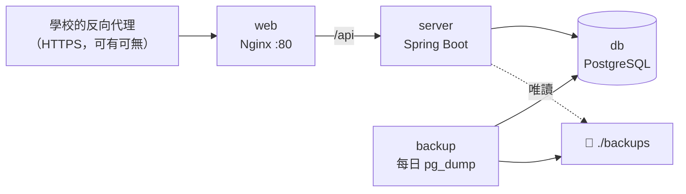

# 部署



對外只開 Nginx（預設 80 埠）。四個容器都在 `docker-compose.prod.yml`。

## 1️⃣ 上線

```bash
cp deploy/env.example .env      # 填資料庫密碼與第一位系統管理員
docker compose -f docker-compose.prod.yml up -d --build
```

| 環境變數 | 說明 |
| --- | --- |
| `TESTA_DB_PASSWORD` | 資料庫密碼，自己產生一組長的隨機字串 |
| `TESTA_ADMIN_EMAIL`、`TESTA_ADMIN_PASSWORD` | 第一位系統管理員。只在資料庫裡還沒有系統管理員時使用，登入後會被要求換密碼 |
| `TESTA_HTTP_PORT` | 對外的埠，預設 80 |
| `TESTA_COOKIE_SECURE` | 走 HTTPS 時保持 `true` |
| `TESTA_BACKUP_DIR`、`BACKUP_KEEP_DAYS` | 備份放哪裡（預設 `./backups`）、保留幾天（預設 30） |

> ⚠️ **區網純 HTTP** 時要把 `TESTA_COOKIE_SECURE` 設成 `false`，否則登入後會立刻被登出。
>
> ⚠️ 正式環境**不要**開 dev profile（它會建立密碼公開的示範帳號）。

登入狀態存在資料庫（`spring_session`），後端重啟後不用重新登入。

### 在學校的 Proxmox VE 上（Dell R760）

建一台 Linux VM 跑 Docker，照上面的步驟上線。不建議用 LXC 跑 Docker，問題比較多。

| 項目 | 建議 | 依據 |
| --- | --- | --- |
| 系統 | Debian 或 Ubuntu LTS，裝 Docker Engine | |
| CPU／記憶體 | 4 vCPU、8 GB | 開發機上 300 位考生同時作答，p99 12 ms，負載很輕；留餘裕給考試當天 |
| 硬碟 | 64 GB 起 | 資料庫很小，主要是備份檔 |
| 網路 | 固定 IP，電腦教室連得到 | 前面若有學校的反向代理，看下一節設定真實 IP |
| 備份 | 程式自己的每日 `pg_dump`＋PVE 的 VM 備份（vzdump 或 PBS） | 兩層：一層還原資料，一層還原整台機器 |

要跟資訊單位確認：分配多少 CPU 與記憶體、有沒有 GPU（之後要跑 AI 才需要）、電腦教室到主機的網段與防火牆、HTTPS 憑證由誰處理、有沒有 Proxmox Backup Server。

## 2️⃣ 前面有反向代理時

Nginx 的限流與操作紀錄裡的 IP 都以來源 IP 計算。如果前面還有一台代理，所有人看起來都來自那台代理，會共用同一份限流額度。照 `deploy/nginx.conf` 開頭的說明設定 `set_real_ip_from`。

## 3️⃣ 改了 `deploy/` 裡的設定之後

要重啟 web 容器：

```bash
docker compose -f docker-compose.prod.yml restart web
```

只做 `nginx -s reload` 不夠。多數編輯器與 `git pull` 存檔時會把檔案整個換掉，容器裡掛載的還是舊的那一份，reload 會報找不到設定檔。

## 💾 備份與還原

- 資料庫每天備份到 `TESTA_BACKUP_DIR`，保留 `BACKUP_KEEP_DAYS` 天。
- 系統管理員可以在後台的「備份」分頁確認備份有在跑；超過 26 小時沒有新檔會提醒。網頁上只能看，不能下載或還原。
- 要立刻多備份一次：`docker compose -f docker-compose.prod.yml restart backup`

還原會把資料庫**整個換成**備份當時的內容，先停後端：

```bash
docker compose -f docker-compose.prod.yml stop server
gunzip -c backups/testa-YYYYmmdd-HHMMSS.sql.gz | docker compose -f docker-compose.prod.yml exec -T db psql -U testa -d testa -v ON_ERROR_STOP=1 --single-transaction
docker compose -f docker-compose.prod.yml start server
```

## ✅ 部署後檢查

```bash
python3 deploy/smoke-test.py http://主機:埠 管理員帳號 管理員密碼
```

用真的 HTTP 走完一場模擬考：建帳號、題庫、考試、作答、評分、公布、考生查成績、緊急檢視、封存。

> ⚠️ **只對測試環境執行。** 它會在資料庫留下「冒煙測試」開頭的資料，而且會把管理員的臨時密碼換掉。
