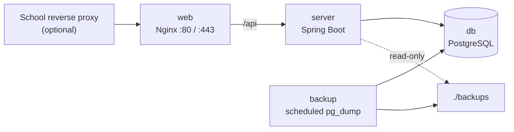

# Deployment

**English** | [繁體中文](deployment.zh-TW.md)

This guide covers a production install on one Linux server: configuration, HTTPS, running exams without Internet access, upgrades, and backup and restore.



Only Nginx is exposed (port 80 by default, plus 443 with HTTPS). All four containers are in `docker-compose.prod.yml`.

- The Compose project is named `tpcu-testa`; the database lives in the `tpcu-testa_db-data` volume and survives restarts, rebuilds and upgrades. `docker compose down -v` deletes it.
- `docker compose -f docker-compose.prod.yml ps` shows each container's health. The backend is healthy when `/api/health` answers and the database is reachable (otherwise 503); Nginx waits for it.
- Container logs rotate at 10 MB, five files per container: `docker compose -f docker-compose.prod.yml logs -f server`.

## Prepare an Ubuntu server

On a recent Ubuntu server, install Docker Engine, Compose v2, Buildx and Git from Ubuntu's package repository:

```bash
sudo apt-get update
sudo apt-get install -y ca-certificates curl git docker.io docker-compose-v2 docker-buildx
sudo systemctl enable --now docker
sudo usermod -aG docker "$USER"
```

Sign out and back in once so the Docker group takes effect, then verify the installation:

```bash
docker --version
docker compose version
docker buildx version
```

If the VM is reachable only through an SSH bastion, connect without copying private keys to the bastion:

```bash
ssh -J <USER>@<BASTION_IP> <USER>@<SERVER_IP>
```

You can put equivalent `Host`, `HostName`, `User` and `ProxyJump` entries in your local `~/.ssh/config`. Keep real addresses and credentials in the operator's private records, not in this repository.

## Going live

```bash
cp deploy/env.example .env      # at least the database password
docker compose -f docker-compose.prod.yml up -d --build
```

Then open the site at once: with no system administrator yet it shows the first-run setup page, and **whoever opens it first becomes the system administrator**. There is no setup token, so create the first administrator immediately after the first start, before the site is reachable by anyone else (for example before the DNS record or the firewall rule for the labs is in place). Setup closes for good once an administrator exists, so there are no default credentials and no administrator password in `.env`. If someone else got there first, stop the stack and start again with an empty database (`down -v`).

| Variable | Meaning |
| --- | --- |
| `TESTA_DB_PASSWORD` | Database password; generate a long random string |
| `TESTA_HTTP_PORT` | Public port, default 80 |
| `TESTA_COOKIE_SECURE` | Keep `true` behind HTTPS |
| `TESTA_TZ` | Time zone for logs and backup file names, default `Asia/Taipei` |
| `TESTA_BACKUP_DIR`, `BACKUP_KEEP_DAYS` | Where backups go (default `./backups`) and for how many days (default 30) |

> **Plain HTTP on a LAN**: set `TESTA_COOKIE_SECURE` to `false`, or users are signed out right after signing in.
>
> **Never** enable the dev profile in production: it creates demo accounts with public passwords.

Sessions are stored in the database (`spring_session`), so a backend restart does not sign anyone out.

### Server sizing

A single Linux VM running Docker Engine is enough. The full list to request from the IT office is in [Estimated server configuration](server-requirements.md). On Proxmox VE, use a VM rather than an LXC container.

| Item | Recommendation | Reason |
| --- | --- | --- |
| OS | Debian or Ubuntu LTS with Docker Engine | |
| CPU and memory | 4 vCPU, 8 GB | 300 concurrent candidates measured p99 12 ms on a laptop; this leaves headroom |
| CPU type (Proxmox/QEMU) | `host` or `x86-64-v3` | The image build runs Vite and Tailwind native binaries, which crash with "Illegal instruction" on the default QEMU CPU model |
| Disk | 64 GB or more | The database is small; most space is backups |
| Network | A fixed internal IP reachable from the labs | See [Network](#network) |
| Backup | The scheduled `pg_dump` plus VM-level backups (for example vzdump or Proxmox Backup Server) | One restores data, the other the whole machine |

## HTTPS

The site needs a host name such as `exam.example.edu.tw` and a certificate for it. Nothing in the application depends on the name; use the school's own subdomain. Two ways:

**The school's reverse proxy terminates HTTPS** and forwards to this VM's port 80. Nginx rate limits and the audit log use the client IP, so tell Nginx which proxy to trust: uncomment `set_real_ip_from` in `deploy/http.conf` with the proxy's address (trusted proxies only, or anyone can forge their IP).

**This VM terminates HTTPS.** Put `fullchain.pem` and `privkey.pem` in `TESTA_TLS_DIR` (default `./tls`, not in git) and add the override file:

When the certificate authority gives you a server certificate, an intermediate certificate and a matching private key, prepare them as follows. The server certificate must come first in `fullchain.pem`; never commit the resulting files.

```bash
install -d -m 700 tls
cat server.crt intermediate.crt > tls/fullchain.pem
install -m 600 server.key tls/privkey.pem
chmod 644 tls/fullchain.pem
openssl x509 -in tls/fullchain.pem -noout -subject -issuer -dates
```

```bash
docker compose -f docker-compose.prod.yml -f deploy/https.yml up -d
```

Port 80 then only redirects to HTTPS (which assumes `TESTA_HTTPS_PORT` is 443). After replacing the certificate, restart the web container. There is no HSTS header on purpose, so plain HTTP on the internal network stays possible as a fallback.

Either way keep `TESTA_COOKIE_SECURE=true`.

## Network

Where candidates sit is up to each unit:

| Setting | What it needs |
| --- | --- |
| Computer lab | Lab PCs reach the server over the school network |
| Lab PCs blocked from the Internet | The same, and the firewall must still let lab PCs reach the server (check this when the server has a public IP). The server itself can stay online |
| Online from home | A public DNS record for the host name and TCP 443 open from the Internet |

Nothing in an exam needs the Internet: the application, its fonts and scripts, sign-in and the database are all on this VM. What must work is the path from candidates to the server; if it breaks, saved answers are kept, candidates resume when it returns, and proctors can add time.

To arrange with the network administrators:

| Item | What is needed |
| --- | --- |
| DNS | An internal record for the exam host name on the school's DNS servers, so lab PCs resolve it even when blocked from the Internet. Online exams also need a public record |
| Routing and firewall | Lab subnets/VLANs to the server on TCP 443 (and 80 for the redirect); from the Internet only for online exams |
| Certificate | Issued for the exam host name (a public CA or the school's wildcard certificate; an internal CA only if every candidate's PC trusts it). Check the expiry date before each exam period with `openssl x509 -enddate -noout -in tls/fullchain.pem` |
| Time | The server clock decides exam timing, so the VM needs NTP (a public server, or the hypervisor host or a school server if the VM has no Internet). Candidates' clocks do not matter |
| Outbound | For building images and upgrades (Docker Hub, Maven Central, npm). Never build or upgrade on an exam day |

Blocking the Internet does not make an exam secure on its own: candidates on the internal network can still reach each other and other internal services, so lab isolation is the school's responsibility; the application enforces sign-in, timing and access on the server.

Testa has no video proctoring or lockdown browser and only counts how often a candidate leaves the window, so a unit relying on online exams for high-stakes results has to arrange its own supervision.

## AI question import (optional)

Off until a system administrator turns it on in Admin > System settings and enters the address of an OpenAI-compatible endpoint (`TESTA_AI_URL` in `.env` presets it). Run the model on a separate VM. It is idle unless a teacher imports a paper; if that VM shares a physical host with the exam server, cap its CPU so an import during an exam cannot slow the exam down. Details and limits: [AI features](ai.md#question-import).

## Upgrades

Never upgrade during an exam. Sessions survive a backend restart, but schema changes are one-way.

```bash
docker compose -f docker-compose.prod.yml restart backup     # fresh backup first
git pull
./deploy/render-media.sh videos                              # after UI changes: rebuild manual clips in an isolated demo stack
docker compose -f docker-compose.prod.yml up -d --build       # Flyway migrates the database on start
docker compose -f docker-compose.prod.yml ps                  # wait until server and web are healthy
```

To roll back: check out the previous commit, rebuild, and if the new version changed the schema (a new `V*__*.sql`), restore the backup taken before the upgrade (see below). Try upgrades on a test VM first and run `deploy/smoke-test.py` there.

## After changing files in `deploy/`

Restart the web container:

```bash
docker compose -f docker-compose.prod.yml restart web
```

`nginx -s reload` is not enough. Most editors and `git pull` replace the file, so the container still has the old mount and reload fails to find the config.

## Backup and restore

- The database is backed up to `TESTA_BACKUP_DIR`, daily at 02:00 by default. The schedule (on or off, every 6 or 12 hours, daily or weekly, and the hour) and the retention period are set in Admin > Backups; retention starts at `BACKUP_KEEP_DAYS` (default 30). A new site gets its first backup as soon as the backup container starts.
- In Admin > Backups, an administrator can take a backup now, download, delete or restore one. Delete asks for confirmation; restore also asks the administrator to type 「還原」. Every action is audited. A dump contains papers and personal data, so store downloaded copies securely.
- The backend never writes dumps. It leaves a request in a small control volume, and the separate `backup` container does the work.

### Restoring from the admin panel

1. The site goes into maintenance: every API request returns 503 and the sign-in page waits.
2. The current database is backed up first. If that fails, nothing is replaced.
3. The chosen dump replaces the database in one transaction. If it fails, the old data stays.
4. The site comes back. Sessions are those saved in the dump, so people may need to sign in again.

Do not restore during an exam: answers saved after the backup are lost. A dump from another Testa version (different number of database migrations) is refused; restore it on the host as below, so the backend migrates the schema when it starts.

### Restoring on the host

Use this for a dump from another version, or when the site does not start. Restoring **replaces** the whole database with the backup. Stop the backend first:

```bash
docker compose -f docker-compose.prod.yml stop server
gunzip -c backups/testa-YYYYmmdd-HHMMSS.sql.gz | docker compose -f docker-compose.prod.yml exec -T db psql -U testa -d testa -v ON_ERROR_STOP=1 --single-transaction
docker compose -f docker-compose.prod.yml start server
```

## Post-deploy check

```bash
python3 deploy/smoke-test.py http://HOST:PORT ADMIN_EMAIL ADMIN_PASSWORD
```

Runs a full mock exam over real HTTP: accounts, bank, exam, answering, grading, publishing, candidates checking scores, emergency access, archiving.

> **Run it against a test environment only.** It leaves data prefixed with 「冒煙測試」 and replaces the administrator's temporary password.
