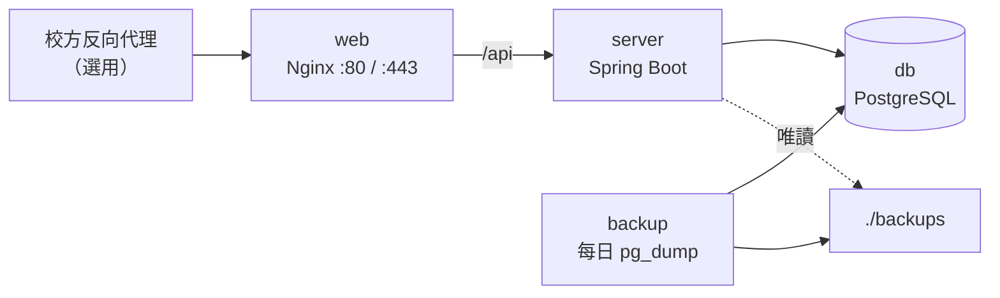

# 部署

[English](deployment.md) | **繁體中文**

本指南說明如何在一台 Linux 伺服器上正式部署：設定、HTTPS、斷網考試、升級、備份與還原。



只有 Nginx 對外開放（預設為 80，加上 HTTPS 時也開放 443）。四個容器都定義在 `docker-compose.prod.yml`。

- Compose 專案名稱為 `tpcu-testa`；資料庫位於 `tpcu-testa_db-data` volume，重新啟動、重建及升級都不會刪除。執行 `docker compose down -v` 會刪除資料庫。
- `docker compose -f docker-compose.prod.yml ps` 會顯示各容器的健康狀態。後端在 `/api/health` 可回應且資料庫可連線時才算健康（否則回傳 503）；Nginx 會等待後端就緒。
- 容器日誌每個檔案上限 10 MB，每個容器保留五份：`docker compose -f docker-compose.prod.yml logs -f server`。

## 準備 Ubuntu 伺服器

在較新的 Ubuntu 伺服器上，從 Ubuntu 套件庫安裝 Docker Engine、Compose v2、Buildx 與 Git：

```bash
sudo apt-get update
sudo apt-get install -y ca-certificates curl git docker.io docker-compose-v2 docker-buildx
sudo systemctl enable --now docker
sudo usermod -aG docker "$USER"
```

登出再登入一次，讓 Docker 群組權限生效，接著驗證安裝：

```bash
docker --version
docker compose version
docker buildx version
```

如果 VM 只能透過 SSH 跳板機連入，可直接使用 ProxyJump，不要把私鑰複製到跳板機：

```bash
ssh -J <使用者>@<跳板機_IP> <使用者>@<伺服器_IP>
```

也可以在本機 `~/.ssh/config` 設定對應的 `Host`、`HostName`、`User` 與 `ProxyJump`。真實 IP、帳密等資訊請放在維運人員的私有紀錄，不要提交到此儲存庫。

## 正式上線

```bash
cp deploy/env.example .env      # 至少設定資料庫密碼
docker compose -f docker-compose.prod.yml up -d --build
```

接著立即開啟網站：系統還沒有管理員時會顯示首次設定頁，**第一個開啟並完成設定的人會成為系統管理員**。系統沒有 setup token，因此第一次啟動後應立刻建立管理員，並在此之前避免其他人連入（例如先不要建立 DNS 紀錄或開放電腦教室的防火牆規則）。管理員建立後，首次設定頁會永久關閉，所以 `.env` 沒有預設帳號或管理員密碼。如果已被他人搶先設定，請停止服務並以空資料庫重新開始（`down -v`）。

| 變數 | 用途 |
| --- | --- |
| `TESTA_DB_PASSWORD` | 資料庫密碼；請產生足夠長的隨機字串 |
| `TESTA_HTTP_PORT` | 對外 HTTP 連接埠，預設 80 |
| `TESTA_COOKIE_SECURE` | 使用 HTTPS 時保持 `true` |
| `TESTA_TZ` | 日誌與備份檔名的時區，預設 `Asia/Taipei` |
| `TESTA_BACKUP_DIR`、`BACKUP_KEEP_DAYS` | 備份位置（預設 `./backups`）及保留天數（預設 30） |

> **校內網路只使用 HTTP**：請把 `TESTA_COOKIE_SECURE` 設為 `false`，否則瀏覽器不會傳送 session cookie，使用者登入後會立刻被登出。
>
> 正式環境**絕對不要**啟用 dev profile；它會建立具有公開密碼的示範帳號。

Session 儲存在資料庫的 `spring_session`，因此重新啟動後端不會讓使用者登出。

### 伺服器規格

一台執行 Docker Engine 的 Linux VM 即可。要向資訊單位申請的完整項目請看[主機預估配置](server-requirements.zh-TW.md)。Proxmox VE 請使用 VM，不要使用 LXC 容器。

| 項目 | 建議 | 原因 |
| --- | --- | --- |
| 作業系統 | Debian 或 Ubuntu LTS，安裝 Docker Engine | |
| CPU 與記憶體 | 4 vCPU、8 GB | 在筆電上實測 300 人同時作答 p99 為 12 ms，仍保留餘裕 |
| CPU 類型（Proxmox/QEMU） | `host` 或 `x86-64-v3` | 使用 QEMU 預設 CPU 類型時，Vite 與 Tailwind 原生程式可能因 Illegal instruction 而中止 |
| 硬碟 | 64 GB 以上 | 資料庫很小，空間主要用於備份 |
| 網路 | 一個電腦教室能連到的固定內部 IP | 詳見[網路與斷網考試](#網路與斷網考試) |
| 備份 | 每日 `pg_dump` 加上 VM 層級備份（例如 vzdump 或 Proxmox Backup Server） | 一份還原資料，另一份還原整台 VM |

## HTTPS

網站需要一個主機名稱（例如 `exam.example.edu.tw`）及對應憑證。應用程式不依賴特定名稱，請使用學校提供的子網域。共有兩種做法：

**由校方反向代理終止 HTTPS**，再轉送到此 VM 的 80 port。Nginx 的流量限制及稽核紀錄需要真實用戶端 IP，因此請在 `deploy/http.conf` 取消 `set_real_ip_from` 的註解並填入可信任代理的位址。只能信任指定代理，否則任何人都能偽造 IP。

**由此 VM 終止 HTTPS。** 把 `fullchain.pem` 與 `privkey.pem` 放入 `TESTA_TLS_DIR`（預設 `./tls`，不得提交到 Git），並加入 HTTPS override 檔案。

如果憑證機構提供伺服器憑證、中繼憑證及相符私鑰，請依下列方式準備。`fullchain.pem` 必須先放伺服器憑證，再放中繼憑證；這些檔案都不可提交到 Git。

```bash
install -d -m 700 tls
cat server.crt intermediate.crt > tls/fullchain.pem
install -m 600 server.key tls/privkey.pem
chmod 644 tls/fullchain.pem
openssl x509 -in tls/fullchain.pem -noout -subject -issuer -dates
```

啟動 HTTPS：

```bash
docker compose -f docker-compose.prod.yml -f deploy/https.yml up -d
```

此時 80 port 只會重新導向 HTTPS（假設 `TESTA_HTTPS_PORT` 為 443）。更換憑證後請重新啟動 web 容器。系統刻意不加 HSTS，讓校內 HTTPS 憑證故障時仍可暫時改用 HTTP。

無論採用哪種方式，都應保持 `TESTA_COOKIE_SECURE=true`。

## 網路與斷網考試

電腦教室透過校內網路連到同一套系統。考試期間可以切斷網際網路：應用程式、字型、程式、登入及資料庫都在此 VM 上，啟動時也不依賴網際網路。但電腦教室到 VM 的**校內路徑**仍必須正常；如果中斷，該教室的考試會暫停（已儲存的答案仍會保留，網路恢復後可接續作答，監考人員也能補時）。

需與網路管理單位確認：

| 項目 | 需求 |
| --- | --- |
| DNS | 考試主機名稱在斷網時仍能解析：使用學校內部 DNS 的 split-horizon 紀錄，指向 VM 內部 IP |
| 路由與防火牆 | 電腦教室網段／VLAN 可連到 VM 的 TCP 443（以及供重新導向使用的 80）；考試不需從網際網路連入 |
| 憑證 | 為考試主機名稱簽發的公開 CA 或校方萬用憑證；若是內部 CA，每台電腦教室電腦都要信任。離線時瀏覽器仍接受有效憑證，但更新可能需要網路；每次考試前以 `openssl x509 -enddate -noout -in tls/fullchain.pem` 檢查期限 |
| 時間 | 伺服器時間決定考試計時，因此 VM 需要可在斷網時使用的 NTP（例如 hypervisor 或校內 NTP）；考生電腦時間不影響考試 |
| 對外連線 | 只在建置映像檔與升級時需要（Docker Hub、Maven Central、npm）；考試當天不要建置或升級 |

切斷網際網路本身不等於安全：校內網路的考生仍可能互相連線或存取其他內部服務，因此電腦教室隔離由校方網路負責；本系統則在伺服器端強制執行登入、計時及權限控制。

## AI 匯入題目（選用）

預設關閉。系統管理員可在「管理 → 系統設定」啟用並輸入 OpenAI 相容端點位址（`.env` 的 `TESTA_AI_URL` 可提供預設值）。模型應放在另一台 VM；除非教師匯入考卷，否則不會使用。如果 AI VM 與考試伺服器共用實體主機，請限制其 CPU，以免考試期間匯入題目影響效能。詳情請看 [AI 功能](ai.md#question-import)。

## 升級

考試進行中絕對不要升級。後端重新啟動不會清除 session，但資料庫 schema 變更是單向的。

```bash
docker compose -f docker-compose.prod.yml restart backup     # 先建立新備份
git pull
docker compose -f docker-compose.prod.yml up -d --build       # 啟動時由 Flyway 更新資料庫
docker compose -f docker-compose.prod.yml ps                  # 等待 server 與 web 變成 healthy
```

若要回復：切換到上一個 commit 後重建；如果新版本新增了 `V*__*.sql` migration，還要還原升級前的備份。請先在測試 VM 演練升級並執行 `deploy/smoke-test.py`。

## 修改 `deploy/` 內的檔案後

請重新啟動 web 容器：

```bash
docker compose -f docker-compose.prod.yml restart web
```

只執行 `nginx -s reload` 不夠。大多數編輯器及 `git pull` 會以新檔案取代舊檔，容器仍持有舊的 bind mount，重新載入時會找不到新設定。

## 備份與還原

- 資料庫每天備份到 `TESTA_BACKUP_DIR`，超過保留天數的備份會自動刪除。保留天數預設為 `BACKUP_KEEP_DAYS`（30 天），之後在「管理 → 系統設定」調整。
- 管理員可在「管理 → 備份」立即備份，以及下載、刪除或還原任一份備份。刪除需要再次確認；還原除了確認，還要輸入「還原」兩個字。每個操作都會留下操作紀錄。備份包含考卷與個人資料，下載後必須妥善保管。
- 後端不會直接寫入備份檔，只在一個小的控制目錄留下要求，由獨立的 `backup` 容器執行。

### 從管理頁還原

1. 網站進入維護狀態：所有 API 回應 503，登入頁會等待。
2. 先自動備份目前的資料庫；這一步失敗就不會取代任何資料。
3. 以選定的備份在單一交易內取代資料庫；失敗時保留原本的資料。
4. 網站恢復。登入狀態以備份當時為準，可能需要重新登入。

請勿在考試進行中還原：備份之後才儲存的答案會遺失。來自不同 Testa 版本（資料庫 migration 數量不同）的備份會被拒絕，請依下方步驟在主機上還原，後端啟動時會自動升級資料表。

### 在主機上還原

用於不同版本的備份，或網站無法啟動時。還原會**取代整個資料庫**，請先停止後端：

```bash
docker compose -f docker-compose.prod.yml stop server
gunzip -c backups/testa-YYYYmmdd-HHMMSS.sql.gz | docker compose -f docker-compose.prod.yml exec -T db psql -U testa -d testa -v ON_ERROR_STOP=1 --single-transaction
docker compose -f docker-compose.prod.yml start server
```

## 部署後檢查

```bash
python3 deploy/smoke-test.py http://HOST:PORT ADMIN_EMAIL ADMIN_PASSWORD
```

此指令會透過真實 HTTP 執行一場完整模擬考：帳號、題庫、考試、作答、閱卷、公布、考生查成績、緊急存取與封存。

> **只能對測試環境執行。** 它會留下名稱帶有「冒煙測試」的資料，並更換管理員的臨時密碼。
