# Screenshots

The production build with demo data, in the order an admission exam runs. Desktop at 1440 x 900; phone at 390 px wide.
Retake them after visible UI changes (see "Retaking" at the end).

## Signing in

| Desktop | Phone |
| --- | --- |
|  |  |

Candidates sign in with the candidate number and login code from their slip; staff switch to the second tab.

## Teachers: question banks

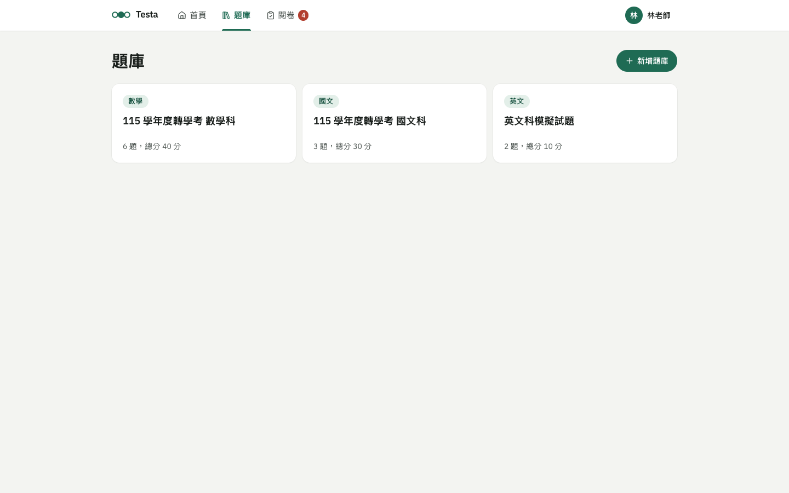

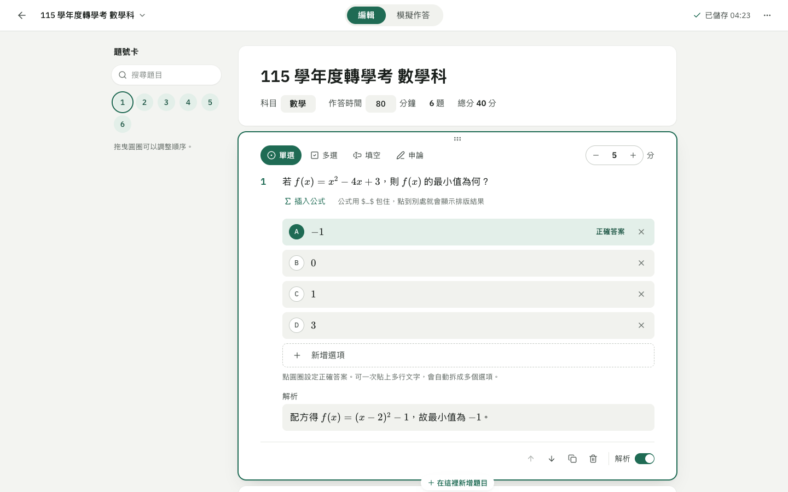

The editor saves automatically. Math is typed as `$...$` and rendered with KaTeX, bundled with the app.

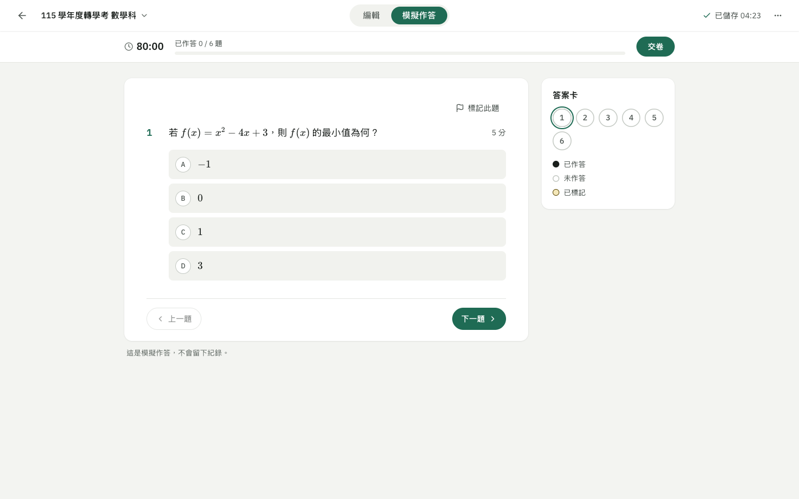

"Try it" shows the bank exactly as a candidate will see it.

## Exam officer: scheduling and proctoring

The home page lists what needs doing next for each exam.

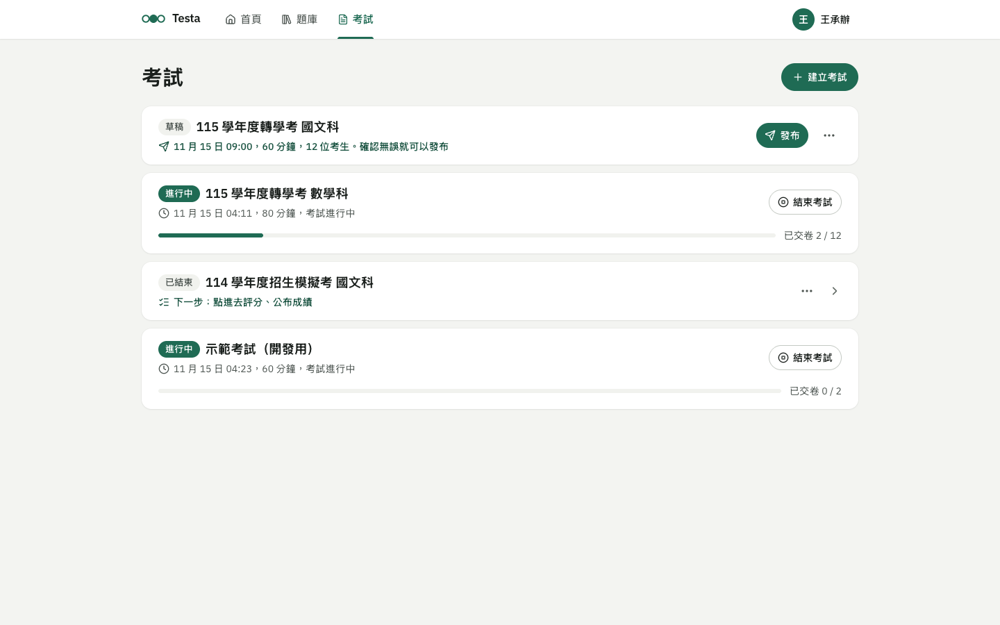

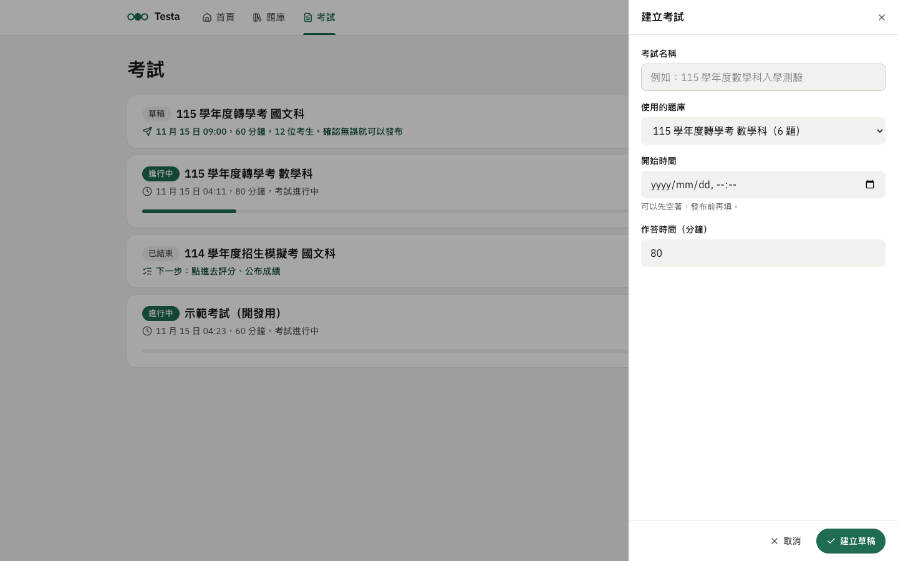

| Desktop | Phone |
| --- | --- |
| 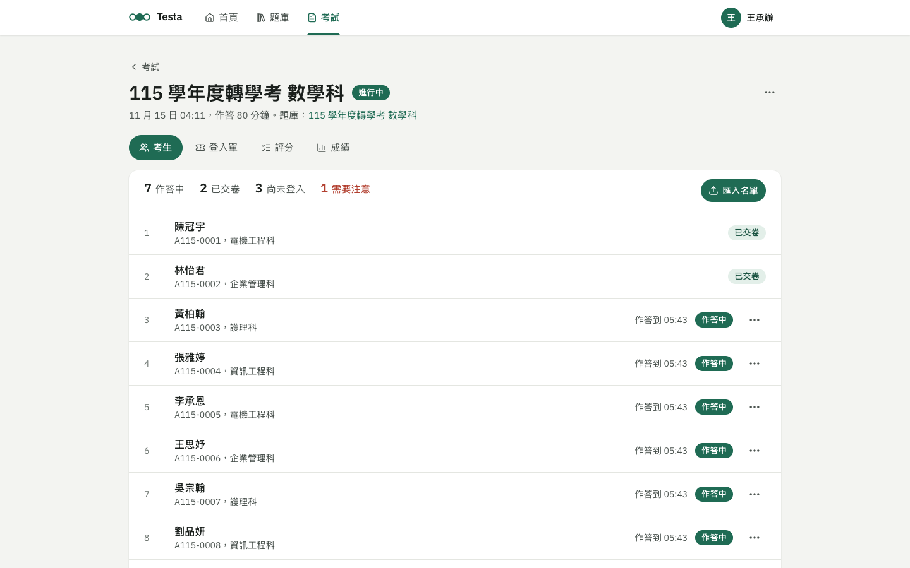 | 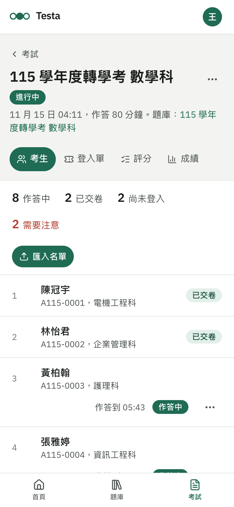 |

Proctoring refreshes every 10 seconds. Clicking a count shows only those candidates, for example "needs attention" (locked out by wrong codes, or left the exam window).

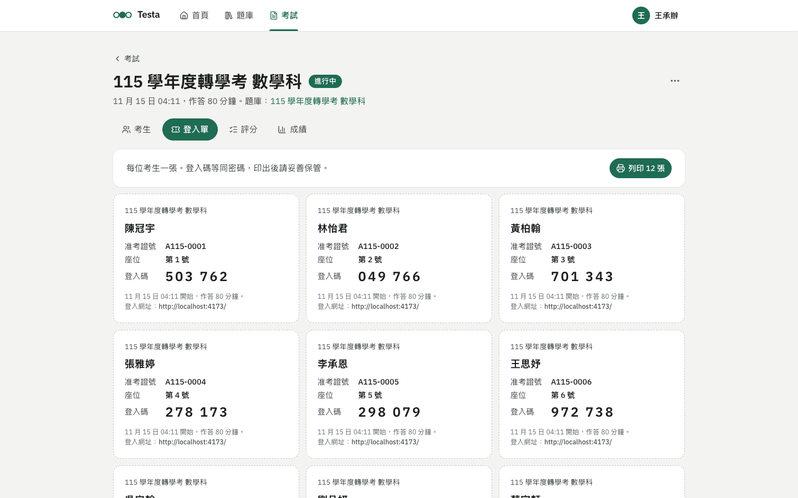

One slip per candidate, printed from the browser.

## Candidates

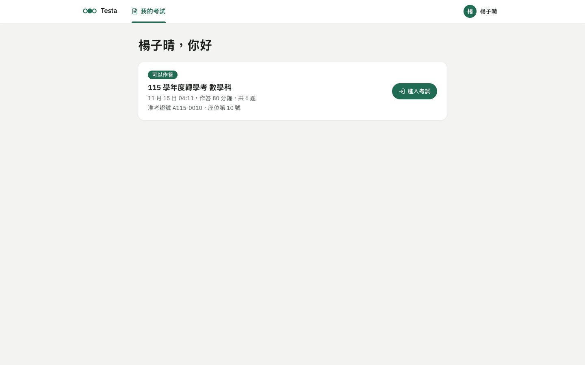

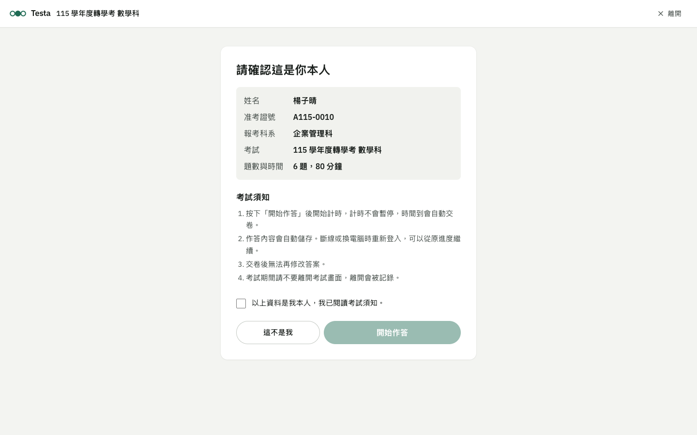

| Desktop | Phone |
| --- | --- |
|  | 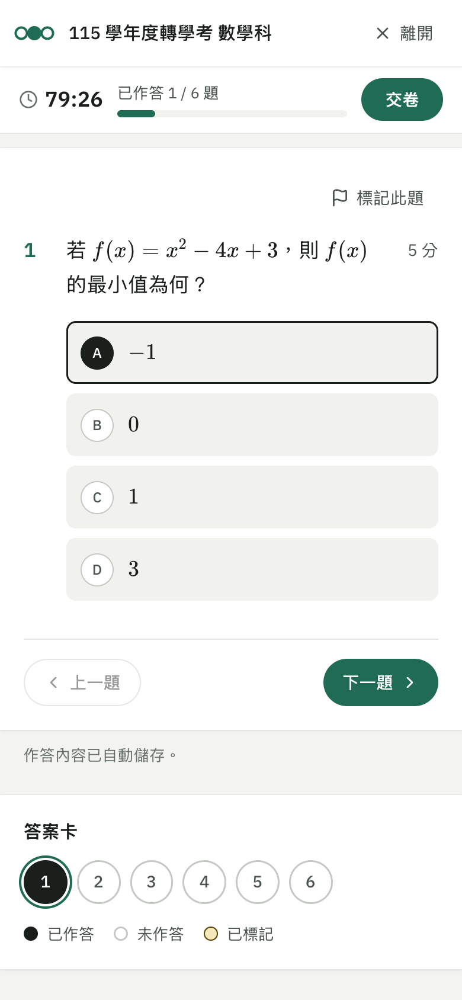 |

The clock is display only; timing and auto-submit are on the server. Answers save as they change.

## Grading and results

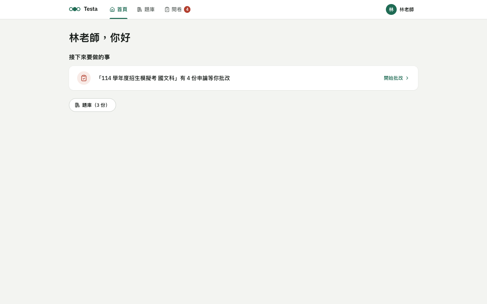

| Desktop | Phone |
| --- | --- |
| 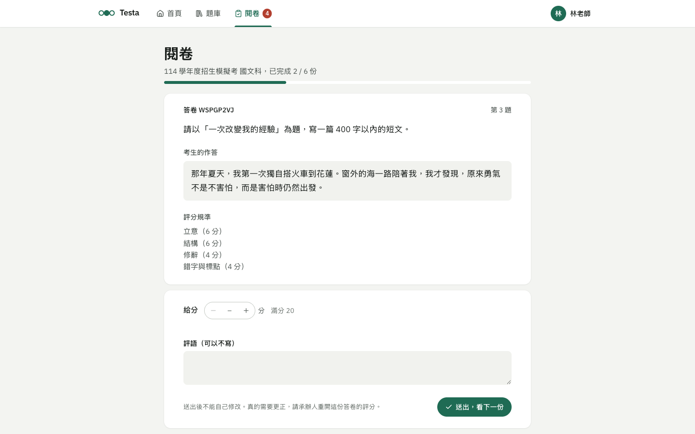 | 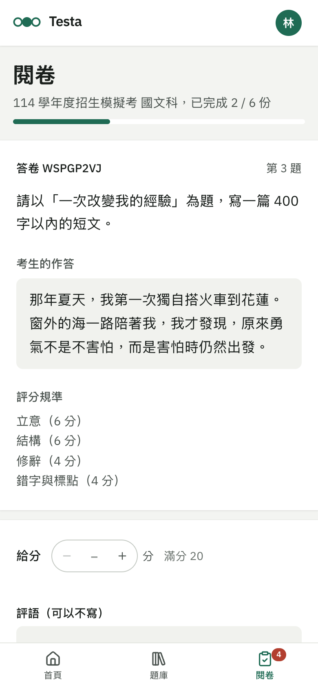 |

Graders see one anonymous answer at a time and must enter a score (0 included) before submitting.

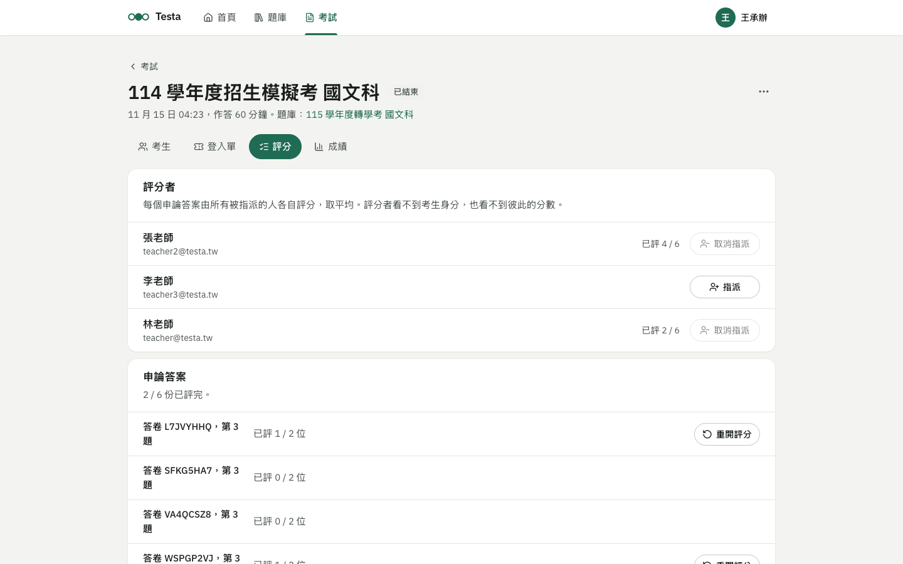

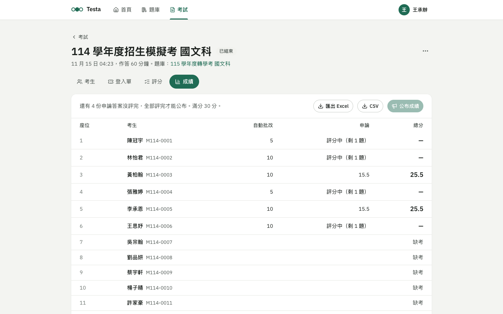

Results can be published once the exam has ended and every essay is graded.

## System administrators

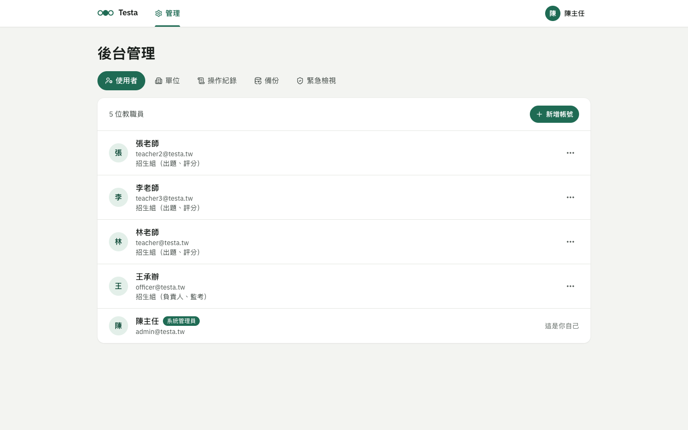

The audit log is append-only and can be filtered by action.

## Retaking

1. Run the backend in the dev profile against an empty database, and serve the production build: `cd testa && npm run build && npx vite preview`.
2. Create realistic demo data through the API (banks, an exam in progress, an ended exam with essays half graded, a draft), the same way `deploy/smoke-test.py` does.
3. Capture with a headless browser at 1440 x 900 (1x) and 390 x 844 (2x). Keep names and the demo data free of real people and school details.
