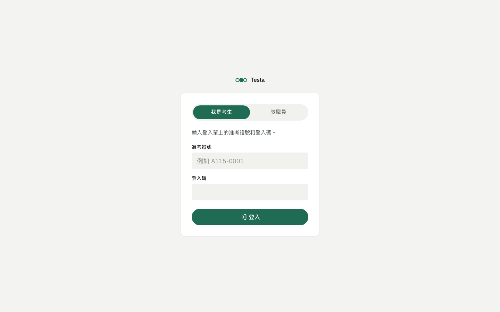
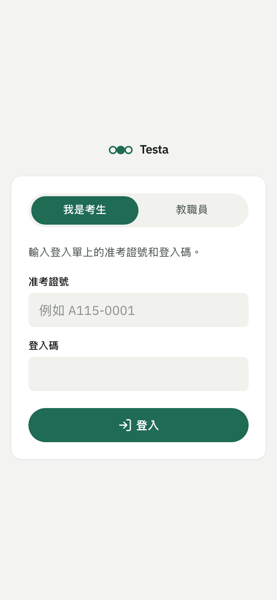
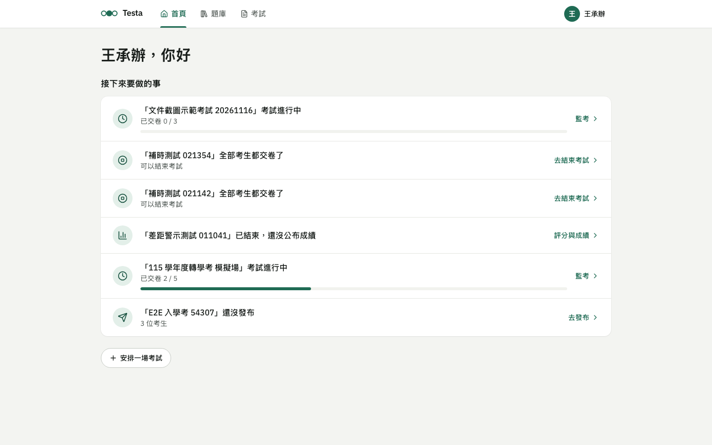
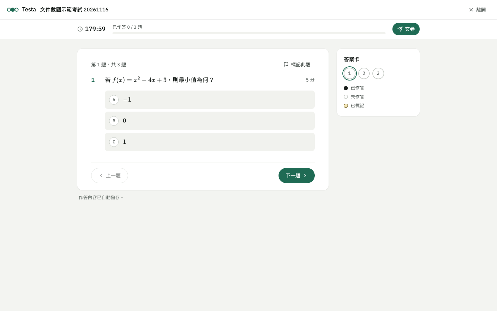
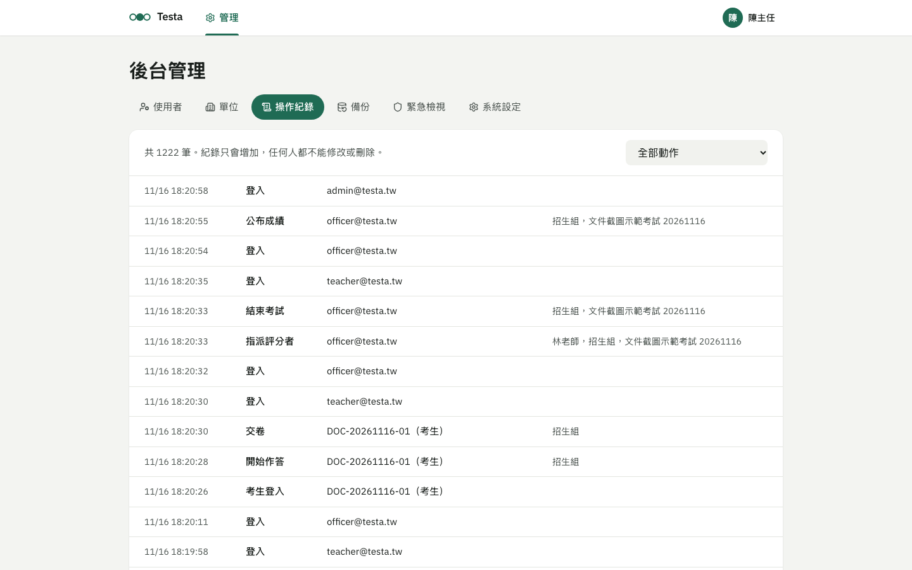

# Screenshots

**English** | [繁體中文](screenshots.zh-TW.md)

The production build with demo data, in the order an admission exam runs. Desktop at 1440 x 900; phone at 390 x 844 (2x).
Retake them after visible UI changes (see "Retaking" at the end).

## Signing in

| Desktop | Phone |
| --- | --- |
|  |  |

Candidates sign in with the candidate number and login code from their slip; staff switch to the second tab.

## Teachers: question banks

The editor saves automatically. Math is typed as `$...$` and rendered with KaTeX, bundled with the app.

"Try it" shows the bank exactly as a candidate will see it.

## Exam officer: scheduling and proctoring

The home page lists what needs doing next for each exam.

| Desktop | Phone |
| --- | --- |
|  |  |

Proctoring refreshes every 10 seconds. Clicking a count shows only those candidates, for example "needs attention" (locked out by wrong codes, or left the exam window).

One slip per candidate, printed from the browser.

## Candidates

| Desktop | Phone |
| --- | --- |
|  |  |

The clock is display only; timing and auto-submit are on the server. Answers save as they change.

## Grading and results

| Desktop | Phone |
| --- | --- |
|  |  |

Graders see one anonymous answer at a time and must enter a score (0 included) before submitting.

Results can be published once the exam has ended and every essay is graded.

## System administrators

The audit log is append-only and can be filtered by action.

Backups can be taken, downloaded, deleted and restored here. Delete and restore sit in the "..." menu and ask for confirmation; restore also asks the administrator to type 「還原」, and is refused while candidates are answering.

Everything a site may need to adjust, in plain words: AI import, grading flags, data retention, backup retention and sign-in lockout.

## Retaking

`tools/capture-screenshots.mjs` creates the demo data through the API and saves every image above. It drives Chrome over the DevTools protocol, so it needs no extra dependency.

1. Run the backend in the dev profile, with a backup directory so the backup tab has content: `TESTA_BACKUP_PATH=/tmp/testa-backups TESTA_BACKUP_CONTROL_PATH=/tmp/testa-control ./mvnw spring-boot:run -Dspring-boot.run.profiles=dev` (put a few `testa-YYYYmmdd-HHMMSS.sql.gz` files in the first one).
2. Serve the production build, so the dev-only demo sign-in buttons are hidden: `cd testa && npm run build && npx vite preview`.
3. From the repository root: `node tools/capture-screenshots.mjs` (set `CHROMIUM` if Chrome is not in `/Applications`, and `TESTA_APP` if the preview is not on `http://localhost:4173/`).

Keep the file names so links in the README keep working, and keep the demo data free of real people and school details.
